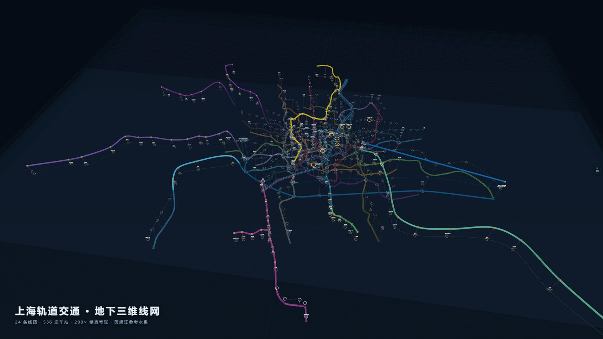
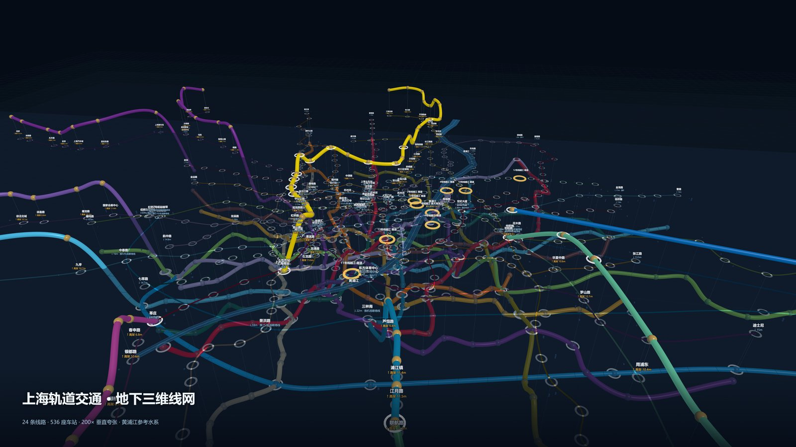
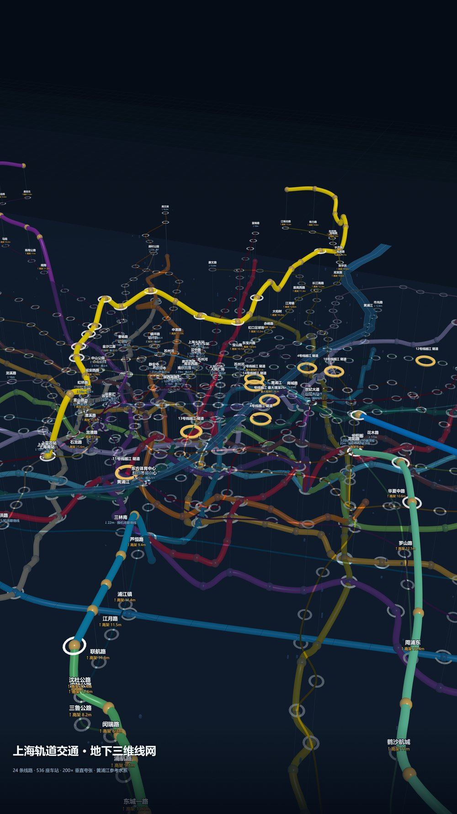
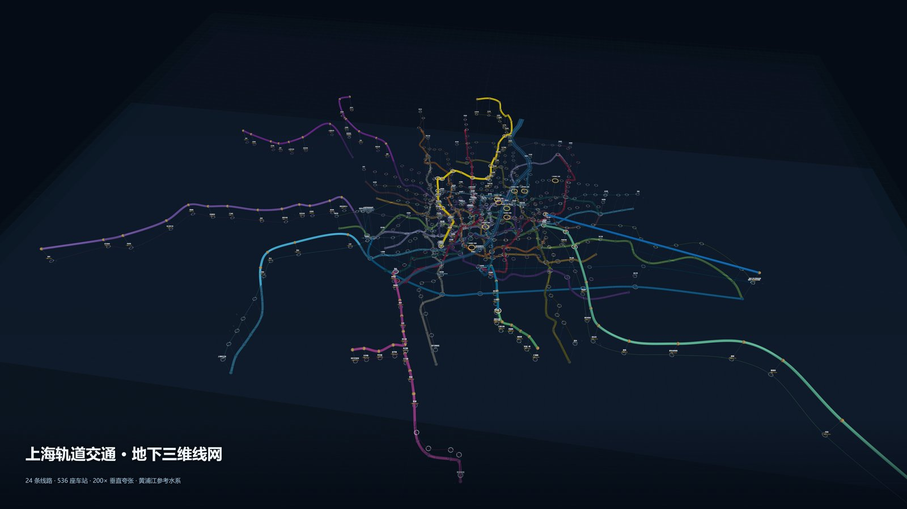

# 中国城市地铁与超级桥梁 · 三维立体视图

> 一个**单文件、零依赖、离线可用**的 3D 可视化网页：把中国 53 座城市的轨道交通线网，按真实经纬度投影到三维空间，用**垂直夸张**呈现地铁埋深起伏、越江隧道、高架区段，并附中国超级桥梁 3D 模型。

> [!WARNING]
> **本项目数据仅供可视化演示与学习参考，禁止用于任何工程、施工、测绘、导航、军事或其他专业用途。**
>
> - **埋深数据为算法生成的示意值**，非实测数据，与真实工程参数无关
> - **坐标精度为公开地图级**（±50–500m），非测绘精度
> - 数据非实时更新，可能与当前实际线网不符
> - 详见 [数据精度与使用限制](#-数据精度与使用限制)

[](https://opensource.org/licenses/MIT)
[]()
[]()
[]()

<p align="center">
  <br>
  <sub>上海 · 24 条线路 / 536 站全网三维总览</sub>
</p>

<p align="center">
  
  
</p>
<p align="center">
  <sub>左：陆家嘴核心区（地标 + 越江标记） · 右：竖版构图（手机端）</sub>
</p>

<p align="center">
  <br>
  <sub>高俯视角 · 线网结构一览</sub>
</p>

---

## ✨ 核心特性

### 三维线网

- **真实经纬度投影**：等距圆柱投影，1 场景单位 = 100 米
- **垂直夸张可调**（30×–400×）：让埋深 15m 的管线在 60km 尺度的线网中清晰可见
- **官方线路色**：各城市地铁官方配色
- **埋深起伏**：地下站按埋深下沉，高架站破土而出，地面站贴地
- **环线闭合**：北京 2/10 号线、郑州 5 号线等环线首尾相连

### 交互

| 功能 | 说明 |
|---|---|
| 城市 / 线路下拉 | 53 城切换，按线网规模分组（主要线网 / 其他城市 / 专题） |
| 全网叠加 | 默认显示所选城市全部线路交织 |
| 线路聚焦 | 选中单线，其余线淡化至 14% 透明度 |
| 站点点击 | 3D 球体或列表点击 → 相机飞行 + 信息卡（类型/线路/换乘/埋深） |
| 越江标记 | 金色脉冲环标示越江隧道位置，含最大埋深标注 |
| 深度着色 | 全网管线按埋深渐变（青→蓝→紫→橙） |
| 沿线巡航 | 沿线路地下轨迹自动飞行 |
| 站点面板 | 桌面端可折叠（默认收起，不遮挡视图），移动端底部抽屉 |
| 深链分享 | `?city=shanghai&line=sh-9` 直达；内置二维码 + 微博/微信/小红书分享 |
| 海报模式 | `?poster=1&city=...&view=core&lng=...&lat=...` 出图（支持 8K 原生渲染） |

### 地理参考

- **36 城水系**：黄浦江、长江、黄河、永定河、钱塘江、珠江、嘉陵江、湘江、胶州湾、维多利亚港等
- 河流逐字标注（大江大字、小河小字，沿河道排布，屏幕字号恒定）
- **65 座地标建筑**（29 城）：东方明珠、上海中心、广州塔、台北 101、中银大厦等，12 种造型（电视塔/扭转塔/开瓶器/斗拱/城堡/门形双塔/仿古…）

### 超级桥梁专题

11 座中国代表性大桥的 3D 模型：港珠澳大桥、深中通道、青岛胶州湾大桥、杭州湾跨海大桥、平潭海峡公铁大桥、苏通大桥、五峰山长江大桥、南京长江大桥、杨泗港长江大桥、北盘江大桥、矮寨大桥。

含桥面、桥塔、斜拉索、悬索主缆与吊索、山谷地形。

---

## 🚀 快速开始

### 方式一：直接用浏览器打开

```bash
git clone https://github.com/DeXuan/metro3d.git
cd metro3d
# 双击 index.html 即可（完全离线，无需服务器）
```

### 方式二：本地服务器（推荐，避免部分浏览器的 file:// 限制）

```bash
python -m http.server 8000
# 打开 http://localhost:8000/
```

> 单文件自包含：Three.js r160 + OrbitControls 已内联，**零外部请求、零 CDN 依赖**，可离线使用。

---

## 📊 数据规模

| 指标 | 数值 |
|---|---|
| 城市 | **53**（中国大陆 51 + 台北/桃园/高雄/澳门/香港） |
| 线路 | **374** |
| 站点（站次） | **8164** |
| 换乘站 | 2237 站次（27.4%） |
| 水系 | 36 城 |
| 地标 | 65 座（29 城） |
| 越江标记 | 39 处（11 城） |
| 单文件体积 | 2.3 MB（gzip 后约 490 KB） |

内置技术栈：Three.js r160（MIT）单文件内联，无构建步骤、无依赖安装。

---

## 🗂 项目结构

```
metro3d/
├── index.html              # ★ 完整应用（单文件，2.3MB，含内联引擎与数据）
├── lib/
│   ├── three.module.js     # Three.js r160 源码（内联来源，便于升级）
│   └── addons/controls/OrbitControls.js
├── data/
│   ├── metro_all.json      # ★ 全量数据（53 城 / 374 线 / 8164 站）
│   ├── gen_coords.py       # 上海站点坐标生成
│   ├── gen_lines.py        # 上海线路数据生成（含高架/深度规则）
│   ├── gen_cities.py       # 北京/南京/郑州/洛阳数据生成
│   ├── gen30.py            # 30 城数据生成（需自备高德原始 JSON）
│   ├── gen_tw_mo.py        # 台北/桃园/高雄/澳门手工数据
│   ├── refine_depth.py     # 埋深精修（换乘加深/近水加深/端头浅埋）
│   ├── fill_transfers.py   # 换乘关系推导（同名站跨线聚合）
│   ├── add_landmarks*.py   # 地标数据
│   └── ...
├── docs/
│   └── screenshots/        # 文档配图（压缩版）
├── poster/                 # 宣传图（本地生成，git 忽略 8K 大图）
├── DEPLOY.md               # 部署到自建站点的说明
└── deploy.sh / deploy.bat  # 一键部署脚本
```

> `index.html` 是**唯一运行产物**。`data/` 下脚本用于重新生成/更新数据，普通使用者无需关心。

---

## 📡 数据来源

| 数据 | 来源 | 说明 |
|---|---|---|
| **站点经纬度** | [OpenStreetMap](https://www.openstreetmap.org/)（上海）<br>[高德地图地铁图](https://map.amap.com/)（其余城市） | 高德 `srhmap` 接口返回的 `sl` 字段为 WGS84 经纬度 |
| **线路走向 / 站序** | 同上 | 按官方站序排列 |
| **线路颜色** | 高德数据 `cl` 字段 | 各城市官方线路色 |
| **换乘关系** | 同名站跨线聚合推导（距离 <1.2km 视为同站） | 部分依赖原始数据标注 |
| **车站埋深** | **示意值**（见下方说明） | 非实测数据 |
| **高架/地面属性** | 依据线路公开结构知识人工标注 | 如 3/16/17 号线高架为主 |
| **水系** | 手工绘制中心线（参考公开地图） | 示意性河道 |
| **地标建筑** | 手工录入真实经纬度 + 建筑高度 | 造型为几何体近似 |
| **台北/桃园/高雄/澳门** | 手工构建（公开资料） | 坐标为近似值（±300–500m） |

### 🚫 数据精度与使用限制

#### 精度等级

| 数据项 | 精度 | 性质 |
|---|---|---|
| 站点经纬度 | ±50–500 m | 公开地图级（非测绘级） |
| 线路走向 | 折线近似 | 仅表示站点顺序与大致走廊 |
| 车站埋深 | **示意值**（±数米至数十米） | 算法生成，非实测 |
| 高架高度 | 示意值（±3 m） | 按线路类型估算 |
| 水系河道 | 手工绘制的中心线 | 示意性，非精确河道 |
| 地标建筑 | 经纬度真实、造型近似 | 几何体组合，非精确建模 |
| 换乘关系 | 同名站聚合推导 | 可能遗漏或误判 |

#### 禁止用途

本项目**明确禁止**用于以下场景：

- ❌ **工程设计与施工**（埋深、隧道、覆土等参数不可用）
- ❌ **测绘与地理信息生产**（精度不达标，使用需持证单位数据）
- ❌ **导航与位置服务**（坐标精度不足）
- ❌ **军事、国防相关用途**
- ❌ **任何需要法定测绘资质的场景**

#### 合规性说明

- **不涉及国家机密**：项目所有数据均来自公开渠道（高德地图公开接口、OpenStreetMap、公开百科与新闻报道）
- **不含涉密数据**：无实测埋深、无隧道结构尺寸、无覆土厚度、无测绘级控制点
- **不使用受限数据源**：未抓取任何非公开、需授权或标注"内部"的数据
- 高德地图为持证测绘单位，其公开接口数据本身已合规
- 数据使用须遵守各来源的服务条款（见 [THIRD-PARTY-NOTICES.md](THIRD-PARTY-NOTICES.md)）

#### 免责声明

本项目作者不对以下情况承担责任：

1. 因使用本项目数据导致的任何直接或间接损失
2. 数据错误、过时或不完整造成的后果
3. 将本项目用于超出"可视化演示"范围的用途

**如用于任何正式场景，请自行获取权威数据并核实。**

---

### ⚠️ 关于埋深数据（重要）

**本站展示的埋深为工程合理性示意值，不是逐站实测数据。**

原因：地铁站点逐站埋深属于施工图/竣工资料，业内极少公开；公开渠道（维基百科、各地地铁官网、百科）通常只提供线路级典型埋深或个别站点新闻。

生成方法（`data/refine_depth.py`）：
1. **线路基准**：按线龄与工程特征设定基准深度（老线浅埋、新线深埋）
2. **换乘加深** +2.5~6.5m（多层站台、换乘通道）
3. **近水加深** 距河流 <2km 的站点按距离递增加深（越江/滨江段深埋）
4. **端头浅埋** −2~3.5m（首末站常接高架/地面）
5. **确定性抖动**（MD5 哈希，可复现）

如你有某线路的实测埋深资料，欢迎提 PR 替换。

### 免责声明

- 本项目为**技术演示与可视化探索**，数据仅供学习参考，**不作为工程、施工、导航依据**。
- 站点坐标、深度、换乘关系可能存在误差。
- 线路与站点信息随城市轨交建设持续变化，本项目数据非实时更新。
- 各城市地铁名称、线路标识等归各自运营方所有。

---

## 🛠 扩展新城市

数据完全驱动渲染，加城市只需往 `data/metro_all.json` 的 `cities` 数组追加：

```json
{
  "id": "example",
  "name": "示例市",
  "lines": [
    {
      "id": "ex-1",
      "name": "1号线",
      "color": "#4FC2E8",
      "from": "始发站",
      "to": "终到站",
      "lengthKm": 25.3,
      "stations": [
        { "name": "始发站", "lng": 121.4, "lat": 31.2, "type": "underground", "depth": 16.5 }
      ]
    }
  ],
  "landmarks": [
    { "name": "示例塔", "lng": 121.4, "lat": 31.2, "h": 300, "type": "taper", "color": "#9fc8e8", "desc": "300m" }
  ],
  "river": {
    "name": "示例江", "widthM": 400,
    "points": [[121.4,31.2],[121.5,31.25]],
    "crossings": [{ "line": "1号线", "from": "A站", "to": "B站", "label": "1号线过江" }]
  }
}
```

**站点字段**
- `type`: `underground`（地下，用 `depth` 米）/ `elevated`（高架，用 `height` 米）/ `ground`（地面）
- `transfer`: 换乘线路短名数组（可选，如 `["2","8"]`）
- `note`: 备注（可选）

**地标 type**：`tv_tower` / `twist` / `taper` / `opener` / `pagoda` / `pavilion` / `castle` / `gate` / `corn` / `ancient` / `wheel` / `tower`

然后重新内联数据：

```bash
python -c "
import io, json
h = io.open('index.html', encoding='utf-8').read()
d = json.load(open('data/metro_all.json', encoding='utf-8'))
blob = json.dumps(d, ensure_ascii=False, separators=(',', ':'))
i0 = h.index('const METRO_DATA = ')
i1 = h.index(';\n', h.index('\"cities\"', i0))
io.open('index.html','w',encoding='utf-8').write(h[:i0] + 'const METRO_DATA = ' + blob + h[i1:])
"
```

---

## 🎨 海报 / 视频生成

页面内置 **poster 模式**（`?poster=1`）用于出图：

```
?poster=1&city=shanghai&view=overview&wm=0     # 全网总览
?poster=1&city=shanghai&view=core&lng=121.503&lat=31.237&dist=95   # 核心区特写
?poster=1&city=bridges&bridge=0                 # 指定桥梁
```

- `view`: `overview` / `top` / `core` / `river` / `wide`
- `wm`: `0` 隐藏水印，`1` 显示
- 隐藏 UI 后可配合 `renderer.setSize(7680, 4320)` 出 8K 图（WebGL 上限内）

---

## 🤝 贡献

欢迎提交 Issue / PR：

- **数据修正**（站点坐标、站序、换乘关系、真实埋深）
- **新增城市**（按上述格式）
- **视觉优化**（着色方案、标签布局、性能）
- **文档与翻译**

详见 [CONTRIBUTING.md](CONTRIBUTING.md)。

---

## 📄 许可证

代码以 [MIT License](LICENSE) 开源。

第三方组件与数据来源详见 [THIRD-PARTY-NOTICES.md](THIRD-PARTY-NOTICES.md)：
- **Three.js r160** — MIT License（已内联）
- **OrbitControls** — MIT License（已内联）
- 地图数据：OpenStreetMap（ODbL）/ 高德地图

地图数据版权归各数据提供方（OpenStreetMap 贡献者 / 高德地图）。本项目仅用于技术演示。

---

## 🔗 相关

- 在线演示：<https://xn--888-vw3e05fxyzc07e.cn:9006/web/metro3d/>
- 姊妹项目：[上海轨道交通隧道纵断面工程图](https://xn--888-vw3e05fxyzc07e.cn:9006/web/metro-3d/)